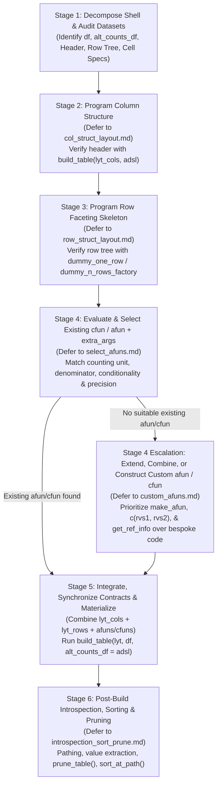

# End-to-End Table Programming in `rtables` & `junco`

This master skill orchestrates the complete translation of a desired table (typically specified as a *table shell* or mock TLF) into a working `rtables` + `junco` implementation.

> [!IMPORTANT]
> **Modular Architecture — Defer to Specialist Sub-Skills**
> Programming a table in `rtables` is governed by **four distinct layout responsibilities plus post-build introspection**, organized across **five specialist sub-skills**. Rather than improvising all aspects at once, always decompose the table and consult the corresponding specialist skill for each part:
> 1. **Column Faceting Structure** $\longrightarrow$ Defer to **[col_struct_layout.md](./col_struct_layout.md)**
> 2. **Row Faceting Structure** $\longrightarrow$ Defer to **[row_struct_layout.md](./row_struct_layout.md)**
> 3. **Marginal Group Summary (`cfun`) & Leaf Analysis (`afun`) Selection** $\longrightarrow$ Defer to **[select_afuns.md](./select_afuns.md)** *(also referred to as `selecting_afuns.md`)*
> 4. **Custom `afun` / `cfun` Extension & Construction (Escalation Only)** $\longrightarrow$ Defer to **[custom_afuns.md](./custom_afuns.md)** **only** when the selection process in [select_afuns.md](./select_afuns.md) confirms that no existing `junco` or `tern` function can satisfy the requirement via `extra_args` alone.
> 5. **Post-Build Introspection, Sorting & Pruning** $\longrightarrow$ Defer to **[introspection_sort_prune.md](./introspection_sort_prune.md)** for all post-`build_table()` operations: navigating the table tree (row/column pathing, wildcards), extracting cell values, removing empty/low-count rows, or reordering rows by computed cell values (e.g., "sort by decreasing incidence").
>
> Use **this orchestrator skill** to decompose the shell, coordinate the sub-tasks in order, enforce cross-dimension integration contracts (data preprocessing, `alt_counts_df`, `ref_path`, `denom_by`, `multivars`, and top-left labels), and assemble the final `build_table()` pipeline.

---

## 1. The `rtables` Conceptual Model & Orthogonality Principle

`rtables` models data-summarizing tables as **faceted data visualizations** (analogous to `ggplot2::facet_grid`), separating **structural data partitioning** from **statistical cell calculation**.

### 1.1 The Four Building Blocks of Every Table Layout
Every `rtables` layout (`PreDataTableLayouts`, initialized with `basic_table()`) declares up to four structural elements before being evaluated against data via `build_table(lyt, df, alt_counts_df = ...)`:

| Building Block | Primary API Family | What It Does | Specialist Skill |
| :--- | :--- | :--- | :--- |
| **1. Column Structure** | `split_cols_by*()`, `grouped_cols_w_diffs()`, `grouped_cols_w_subgrps()`, `shift_tbl_col_struct()`, `some_v_all_col_struct()`, `add_overall_col()`, `add_colcounts()` | Defines leaf columns, spanning headers, column subsetting expressions, and header `(N=xx)` counts. **Nothing else affects column structure.** | [col_struct_layout.md](./col_struct_layout.md) |
| **2. Row Faceting Structure** | `split_rows_by*()` (`split_rows_by`, `_cuts`, `_cutfun`, `_quartiles`, `_multivar`) | Partitions data into hierarchical row groups, controls nesting (`nested`, `at_sibling`), and configures facet labels (`label_pos`, `child_labels`), dividers (`section_div`), and pagination (`page_by`, `split_rows_by()` only). **Does not create leaf rows on its own.** | [row_struct_layout.md](./row_struct_layout.md) |
| **3. Marginal Group Summary Rows** | `summarize_row_groups(..., cfun = ...)` | Attaches a content function (`cfun`) to the immediately preceding `split_rows_by*()` (or root), replacing or augmenting each facet's label row with marginal summary cells. | Placement: [row_struct_layout.md](./row_struct_layout.md)<br>Function choice: [select_afuns.md](./select_afuns.md)<br>Custom/extended `cfun`: [custom_afuns.md](./custom_afuns.md) |
| **4. Individual Analysis Leaf Rows** | `analyze(..., afun = ...)` | Terminates a row-faceting branch by applying an analysis function (`afun`) to the intersection of each `(row_facet, col_facet)` data subset to generate one or more leaf rows. | Placement: [row_struct_layout.md](./row_struct_layout.md)<br>Function choice: [select_afuns.md](./select_afuns.md)<br>Custom/extended `afun`: [custom_afuns.md](./custom_afuns.md) |

### 1.2 Why Incremental Translation Works: Structural Orthogonality
In `rtables`:
1. **Column splits and row splits are syntactically orthogonal**: You can build and test the entire column header structure (`build_table(lyt_cols, adsl)`) with zero row instructions, and you can build and test the entire row hierarchy (`build_table(lyt_rows, df)`) under a single default `all obs` column using dummy analysis functions (`dummy_one_row`, `dummy_n_rows_factory(k)`).
2. **Faceting handles data subsetting automatically**: Neither `afun` nor `cfun` needs to filter data for standard row or column categories; `rtables` automatically passes the intersection of the active row facet and column facet to `afun`/`cfun` (while also providing `.df_row`, `.alt_df`, `.alt_df_full`, `.N_col`, and `.spl_context` when wider context is needed).
3. **Where dimensions interact**: When column or row structures are *heterogeneous* or *population-conditioned* (e.g., Risk Difference columns alongside Treatment Arm columns, 3-column `[n/N, Mean, CFB]` layouts, or subgroup row splits requiring subgroup-specific denominators), the column/row layout and the selected `afun`/`cfun` must share specific configuration contracts (covered in Section 4).

---

## 2. The 5-Stage End-to-End Table Programming Workflow

Always follow this 5-stage workflow when programming a table from a shell or specification:



---

### Stage 1: Decompose the Table Shell & Audit Datasets

Before writing layout code, inspect the shell and answer four questions:

1. **What are the input datasets (`df` vs. `alt_counts_df`)?**
   - **Subject-level table** (Demographics, Disposition, Baseline Characteristics): `df` is `adsl`. Usually `alt_counts_df` is not needed (or `alt_counts_df = adsl` if `df` is pre-filtered).
   - **Event-level or repeated-measures table** (Adverse Events `adae`, Concomitant Meds `adcm`, Labs `adlb`, Vital Signs `advs`, Exposure `adex`): `df` is the event/visit dataset, and **`alt_counts_df = adsl` is mandatory** so column header counts `(N=xx)` and subject-level percentage denominators reflect the full treated/safety population rather than only patients with events.
2. **What is the Column Header Topology?**
   - Identify spanning headers, treatment arms, virtual combination arms (e.g., `"All Active"`), non-nested comparison branches (e.g., `"Risk Difference (%) (95% CI)"`), or multi-variable sub-columns (`n/N (%)`, `Mean`, `Change from Baseline`).
3. **What is the Row Faceting Hierarchy?**
   - Identify top-level sections, nested row groups (e.g., `AEBODSYS -> AEDECOD`, `RACE -> SEX`, `PARAM -> AVISIT`), which group headers carry marginal summary values (`summarize_row_groups`) vs. pure labels, and where labels sit (`label_pos = "topleft"`, `"visible"`, or `"hidden"`).
4. **What are the Cell Contents (Marginal `cfun` vs. Leaf `afun`)?**
   - For each row section and group header, note the statistic format (`xx (xx.x%)`, `xx / xx (xx.x%)`, `Mean (SD)`, `LS Mean (95% CI)`), unit of counting (unique subjects vs. events), denominator population, and any column- or row-conditional behavior.

---

### Stage 2: Design & Verify Column Structure $\longrightarrow$ Defer to [`col_struct_layout.md`](./col_struct_layout.md)

Consult **[col_struct_layout.md](./col_struct_layout.md)** to implement the column header layout:

1. **Prefer High-Level `junco` Column Generators First**:
   - Active vs. Comparator spanning header + pairwise difference columns $\to$ `create_colspan_var()`, `create_colspan_map()`, and **`grouped_cols_w_diffs()`**.
   - Arms subdivided by subgroups/quartiles $\to$ **`grouped_cols_w_subgrps()`**.
   - Shift tables (`N | Baseline [Low | Normal | High] | Total`) $\to$ **`shift_tbl_col_struct()`**.
   - Non-mutually exclusive subsets (`All Grades` vs. `Grades 3-5`) $\to$ **`some_v_all_col_struct()`**.
   - Statistics in columns (`N`, `Mean`, `SD`, `SE`, `Med`, `Min`, `Max`) $\to$ `split_cols_by_multivar(...)` + **`stats_in_cols_setup()`**.
   - Pure `rtables` fallback or standard layouts $\to$ `split_cols_by*()`, `add_overall_col()`, `add_combo_levels()`, `trim_levels_to_map()`.
2. **Configure Column Counts (`(N=xx)`)**:
   - Set `show_colcounts = TRUE` and `colcount_format = "N=xx"` (or `"(N=xx)"`) either globally in `basic_table()` or selectively on the primary arm `split_cols_by()` call (so comparison/risk-difference columns do not display nonsensical `(N=xx)` headers).
3. **Isolated Verification**:
   - Test `build_table(lyt_cols, adsl)` by itself to confirm the exact header banner and column counts before adding row instructions.
4. **Outputs to Record for Stages 4 & 5**:
   - Any derived columns added to `adsl` (`colspan_trt`, `rrisk_header`, `rrisk_label`) — **these must also be joined onto `df`**.
   - The reference group column path **`ref_path`** (e.g., `c("colspan_trt", " ", "TRT01A", "Placebo")` or `c("ARM", "B: Placebo")`).
   - Any multi-variable column vector **`multivars`** (e.g., `c("AVAL", "AVAL", "CHG")`).

---

### Stage 3: Design & Prototype Row Faceting Structure $\longrightarrow$ Defer to [`row_struct_layout.md`](./row_struct_layout.md)

Consult **[row_struct_layout.md](./row_struct_layout.md)** to construct the row hierarchy skeleton:

1. **Map Each Section's Row Splits and Terminating `analyze()` Calls**:
   - **Root / Unfaceted Section**: Use `analyze("VAR", var_labels = "...", show_labels = "visible")` directly without an unnecessary `split_rows_by()`.
   - **Stacked Pre-Specified Sections (Archetype 1)**: When a table has multiple pre-specified row sections (each a single `analyze()` call whose custom `afun` emits multiple rows), use `var_labels = "Section Header", show_labels = "visible"` on each `analyze()` call to place a leading label-only header row above the section's analysis rows. **Never emit a leading `rcell(NULL)` from the `afun` for this purpose** — see [custom_afuns.md](./custom_afuns.md) Building Block 6. If an existing afun already produces the correct rows and only the section header label is missing, use it directly with `var_labels`/`show_labels` — no custom wrapper is needed.
   - **Nested Row Hierarchy**: Chain `split_rows_by*()` from outermost to innermost, and terminate every branch with at least one `analyze()` call.
   - **Multi-Section / Stacked Row Layouts**: Remember that any `split_rows_by*()` immediately following an `analyze()` automatically defaults to `nested = FALSE` (returning to the root). To make a multi-section layout reusable inside an outer subgroup split (e.g., `split_rows_by("STRATA1")`), anchor subsequent sections to the first section via **`at_sibling = "<first_var>"`**.
   - **Intermediate Nesting**: Use **`at_sibling = "<anchor_var>"`** (ordered from deepest anchor to shallowest anchor) when placing analyses or splits at intermediate depths of a multi-level hierarchy.
2. **Place `summarize_row_groups()` for Marginal Summary Rows**:
   - Place `summarize_row_groups()` **immediately after** each `split_rows_by*()` whose group header row displays summary statistics in its cells.
   - Leave `child_labels = "default"` when `summarize_row_groups()` emits a single row that acts as the facet's header row; set `child_labels = "visible"` **only** when `summarize_row_groups()` emits multiple summary rows indented *beneath* a plain facet label row.
3. **Select Row Split Functions (`split_fun`)**:
   - **Hierarchically dependent variables** (`AEBODSYS -> AEDECOD` or `REGION -> COUNTRY`): Use `trim_levels_in_group("AEDECOD")` on the outer split (empirical) or `trim_levels_to_map(map)` (prescriptive).
   - **Uniform inner scale across all outer groups** (`RACE -> SEX` or `AEBODSYS -> AETOXGR`): Use `keep_split_levels(...)`, `remove_split_levels(...)`, or `add_overall_level(...)` on the inner split—**never** `drop_split_levels` on the inner split unless ragged inner levels are desired.
   - **Single-variable empirical vs. prescriptive filtering**: Use `drop_split_levels` on outer splits to omit empty categories, or `keep_split_levels()` / `remove_split_levels()` for fixed categories.
   - **Pooled / Overall row facets**: Use `add_overall_level()`, `add_combo_levels()`, or `junco::make_combo_splitfun()`.
4. **Configure Label Placement (`label_pos`, `child_labels`, `show_labels`)**:
   - Set `label_pos = "topleft"` on outer splits when variable titles belong in the top-left corner above row labels; set `label_pos = "visible"` when variable titles appear as in-body section header rows.
5. **Isolated Prototyping with Dummy Functions**:
   - Test `lyt_rows` using `dummy_one_row` and `dummy_n_rows_factory(k)` from [row_struct_layout.md](./row_struct_layout.md) to verify indentation, section dividers, and label visibility before introducing statistical functions.
6. **Page-By Splits for Per-Facet Pagination**:
   - When the table specification calls for a separate page per level of an outer variable (e.g., one page per lab parameter or per subgroup), use `split_rows_by(var, page_by = TRUE, page_prefix = "...")` as the outermost row split.
   - `page_by` splits must be the outermost row structure — they cannot have top-level siblings or be nested inside non-`page_by` splits. When wrapping a multi-section layout with a `page_by` split, all inner sections must use `at_sibling` anchoring (not `nested = FALSE`) to stay inside the `page_by` facet.
   - `page_by` only takes effect during pagination (`paginate_table()`, `export_as_txt()`, `export_as_pdf()`). When printed at the console or via `toString()` — neither of which paginates — the split renders as an ordinary row split.

---

### Stage 4: Evaluate & Select `cfun` and `afun` Functions $\longrightarrow$ Defer to [`select_afuns.md`](./select_afuns.md) (with Escalation to [`custom_afuns.md`](./custom_afuns.md))

First, consult **[select_afuns.md](./select_afuns.md)** (also referred to as `selecting_afuns.md`) to replace every dummy `cfun` and `afun` with an existing production function and `extra_args`:

1. **Answer the Three Fundamental Questions for Every `summarize_row_groups()` and `analyze()` Call**:
   - **Unit of Counting / Analysis**:
     - Unique subjects (`a_freq_j` with `.stats = "count_unique_fraction"` or `"count_unique_denom_fraction"`) vs. total events (`.stats = "count"`) vs. subject's worst toxicity/severity grade (`a_maxlev`) vs. person-years/EAIR (`a_patyrs_j`, `a_eair100_j`, `a_eair_strat_j`) vs. continuous/model summaries (`tern::a_summary`, `column_stats`, `a_summarize_aval_chg_diff_j`, `a_summarize_ancova_j`, `a_summarize_mmrm`, `a_lsmeans`).
   - **Denominator & Target (Sub)Population**:
     - Column arm population from `ADSL` (`denom = "n_altdf"` or `"N_col"` with `alt_counts_df = adsl`).
     - Subgroup-conditioned arm population (`denom = "n_altdf", denom_by = "<row_subgrp_var>"`).
     - Within-cell record count (`denom = "n_df"`), row total (`denom = "n_rowdf"`), or parent facet total (`denom = "n_parentdf"`).
   - **Column, Row, or Dual Conditionality**:
     - Does the layout have Risk/Mean Difference columns? Enable `riskdiff = TRUE` (or `comp_btw_group = TRUE`) and pass `ref_path`.
     - Is it a subgroup header row (`Gender: F   79   66   77`) above comparative detail rows? Use `cfun = a_freq_j` with `.stats = "n_altdf", denom = "n_altdf", denom_by = "SEX", riskdiff = FALSE` on the subgroup `summarize_row_groups()`, and `.stats = "count_unique_denom_fraction", denom = "n_altdf", denom_by = "SEX", riskdiff = TRUE, ref_path = ref_path` on the inner `summarize_row_groups()` and `analyze()`.
     - Are baseline visits or specific factor levels excluded from change-from-baseline or modeling? Use `exclude_visits`, `a_*_with_exclude(exclude_levels = ...)`, or `a_two_tier(drill_down_levs = ...)`.
2. **Configure Specific Requirements**:
   - Statistical test / CI method (`method = "wald"`, `"waldcc"`, `"cmh"`, Mantel-Fleiss `a_proportion_diff_mf`, `ancova = TRUE/FALSE`, etc.).
   - Dynamic decimal precision (`fmt_spec_var_d`, `fmt_spec_df_d`, `format_sigfig_j`, `formats_var = "fmt_d"`, `.formats = "default"`).
3. **Escalation When No Suitable Existing `afun` / `cfun` Is Found $\longrightarrow$ Defer to [`custom_afuns.md`](./custom_afuns.md)**:
   - If (and **only** if) the evaluation in [select_afuns.md](./select_afuns.md) determines that no existing `junco` or `tern` function can produce the required rows/cells via `extra_args`, escalate to **[custom_afuns.md](./custom_afuns.md)** and follow its strict reuse-first hierarchy:
     - **Tier 2 (Wrap with `make_afun`)**: Wrap an existing `s_*` or `a_*` function with `rtables::make_afun()` to lock in `.stats`, `.formats`, `.labels`, `.indent_mods`, `.ungroup_stats`, or curried default arguments.
     - **Tier 3 (Combine / Mutate `RowsVerticalSection`s)**: Write a thin wrapper that calls existing `afun`s and combines or modifies their returned `RowsVerticalSection` objects—either dispatching between two existing `afun`s across columns via `.spl_context`, stacking multiple existing `afun`s vertically via `c(rvs1, rvs2)`, or adjusting indentation/formats via `indent_mod(rvs) <- ...`.
     - **Tier 4 (Bridge Reference Group Paths)**: If an existing function expects `.ref_group` and `.in_ref_col` but the layout uses nested spanning headers (`ref_path`) or an Overall column, write a 3-line adapter calling `junco::get_ref_info(ref_path, .spl_context, .var)` and delegating to the existing function.
     - **Tier 5 (Bespoke `in_rows()` Function)**: Author a fully custom `afun`/`cfun` from scratch **only** when Tiers 2–4 cannot express the calculation, ensuring every column returns the exact same number of rows (even when `nrow(df) == 0`) and uses `.N_col` / `.alt_df_full` rather than `.N_row` or `.N_total` for subject denominators.

---

### Stage 5: Integrate, Synchronize Contracts & Materialize the Table

Combine the column instructions (Stage 2), row instructions (Stage 3), and `cfun`/`afun` specifications (Stage 4) into a single pipeline:

```r
lyt <- basic_table(
  title = "...",
  subtitles = c("..."),
  main_footer = c("..."),
  prov_footer = c("..."),
  show_colcounts = ...,
  colcount_format = "N=xx",
  top_level_section_div = " "
) |>
  # [Stage 2: Column Structure Pipeline]
  ... |>
  # [Stage 3 & 4: Row Splits + summarize_row_groups(cfun, extra_args) + analyze(afun, extra_args)]
  ... |>
  # [Optional Top-Left Leaf Label]
  append_topleft("...")

tbl <- build_table(lyt, df = anl_df, alt_counts_df = adsl)
```

Before executing `build_table()`, verify all **Six Cross-Dimension Integration Contracts** in Section 3 below.

---

### Stage 6: Post-Build Introspection, Sorting & Pruning $\longrightarrow$ Defer to [`introspection_sort_prune.md`](./introspection_sort_prune.md)

After `build_table()` returns, **all operations on the built `TableTree` object** — navigating its structure, extracting values, removing rows, and reordering rows — are covered by **[introspection_sort_prune.md](./introspection_sort_prune.md)**. Defer to that skill for:

- **Pathing**: Row and column path construction, layout-instruction-to-path mapping, `"*"` wildcards, `"@content"` navigation, discovery tools (`table_structure`, `row_paths_summary`, `col_paths_summary`).
- **Value extraction**: `cell_values`, `row_values`, `value_at`, `tt_at_path` — including wildcard support differences between row and column paths.
- **Pruning**: Removing empty or low-count rows/subtrees (e.g., "omit SOCs with zero subjects"). Built-in and custom pruning functions (`prune_empty_level`, `low_obs_pruner`, `count_pruner`, `bspt_pruner`, custom `prune_func`).
- **Sorting**: Reordering rows by computed cell values (e.g., "sort SOC and PT by decreasing incidence"). Built-in and custom score functions (`jj_complex_scorefun`, `cont_n_allcols`, `cont_n_onecol`, column-path-based scorers, category pinning).
- **Recipes**: Common post-processing patterns (AE incidence sort, reference-column sort, multi-level hierarchical sort, spanning-header-aware sort).
- **Debugging**: Path resolution errors, score function input inspection, sort result verification.

**Always prune before sorting** — pruning removes empty subtrees that would otherwise cause score function errors or produce misleading sort orders.

```r
tbl <- build_table(lyt, df, alt_counts_df = adsl) |>
  prune_table() |>
  sort_at_path("AEBODSYS", cont_n_allcols, decreasing = TRUE) |>
  sort_at_path(c("AEBODSYS", "*", "AEDECOD"), pt_scorefun, decreasing = TRUE)
```

---

## 3. Cross-Dimension Integration Contracts

When combining column layouts, row layouts, and analysis functions, the following six contracts must hold:

### Contract 1: Dataset Synchronization Between `df` and `alt_counts_df`
- Every variable referenced in **any** `split_cols_by*()` call (including helper spanning variables like `colspan_trt`, `rrisk_header`, `rrisk_label`) **must exist on both `df` and `alt_counts_df`** with identical factor levels in the same order.
- Every outer row-split variable referenced in **`denom_by`** (e.g., `denom_by = "SEX"`) **must also exist on both `df` and `alt_counts_df`** with identical factor levels.
- **Standard Idiom**: Create spanning/header variables and factor levels on `adsl` first (e.g., via `create_colspan_var()`), then merge `adsl` columns into the analysis dataset `df` (`adae <- dplyr::left_join(adae, adsl)` or `dplyr::right_join(adae, adsl, by = "USUBJID")`).
- **Factor Level Hygiene After Filtering and Joining**: Filtering `adsl` (e.g., removing `"Screen Failure"`) can leave stale factor levels or convert factors to character. After any filter, re-apply `factor()` to drop unused levels. After joining, synchronize factor levels between `df` and `alt_counts_df`:
  ```r
  adsl <- adsl |> filter(...) |> mutate(TRT01A = factor(TRT01A))
  adae <- adae |> mutate(TRT01A = factor(TRT01A, levels = levels(adsl$TRT01A)))
  ```
  `create_colspan_var()` / `create_colspan_map()` and `grouped_cols_w_diffs()` require factor input with matching levels; character or mismatched-level variables cause `"All facets matched removal criteria"` or `create_colspan_map` errors.

### Contract 2: Reference Path (`ref_path`) Alignment Between Column Layout and `afun`/`cfun`
- Any comparative `junco` function (`a_freq_j(..., riskdiff = TRUE)`, `a_eair100_j(..., riskdiff = TRUE)`, `a_diff_means()`, `a_summarize_ex_j(..., comp_btw_group = TRUE)`, `a_summarize_aval_chg_diff_j()`, `a_summarize_ancova_j()`, `a_lsmeans()`, `a_proportion_diff_j()`, `a_odds_ratio_j()`, `a_relative_risk()`, `a_cmhrms_j()`, `a_patyrs_j()`) requires `ref_path` to point to the exact column tree path of the control/reference group:
  - With spanning header variable `"colspan_trt"` (where control arm `"Placebo"` is under span label `" "`):
    ```r
    ref_path <- c("colspan_trt", " ", "TRT01A", "Placebo")
    ```
  - With flat single-level column split on `"TRT01A"`:
    ```r
    ref_path <- c("TRT01A", "Placebo")
    ```
- Note: `grouped_cols_w_diffs()` automatically wires `ref_path` into the comparison columns' `extra_args`. **When using `grouped_cols_w_diffs()` or any column structure function that auto-injects `ref_path`, `ref_path` must NOT appear in `extra_args`** — doing so causes `"formal argument ref_path matched by multiple actual arguments"` in comparison columns. When building manual `split_cols_by()` comparison branches (without `grouped_cols_w_diffs()`), pass `ref_path = ref_path` explicitly in `extra_args`.
- **Custom / Bridged `afun` Escalation ([`custom_afuns.md`](./custom_afuns.md))**: If you escalate to [custom_afuns.md](./custom_afuns.md) to use an existing `.ref_group`/`.in_ref_col`-based function (or a custom comparative `afun`) inside a spanned column layout: when using `grouped_cols_w_diffs()`, capture `ref_path` from a closure scope (see Tier 4 closure-capture pattern in `[custom_afuns.md](./custom_afuns.md)`); when building column layouts manually with `split_cols_by()`, pass `ref_path` via `extra_args = list(ref_path = ref_path)` and resolve it inside the wrapper with `junco::get_ref_info(ref_path, .spl_context, .var)`.

### Contract 3: Subgroup Row Splits + `denom_by` Conditioning
- Whenever row faceting splits the table by a demographic/baseline subgroup variable (e.g., `split_rows_by("SEX")` or `split_rows_by("AGEGR1")`) and percentages inside each subgroup are out of the **subgroup sample size in that treatment arm** (rather than the full arm `N`), you must:
  1. Pass `alt_counts_df = adsl` to `build_table()`.
  2. Set `denom = "n_altdf"` and `denom_by = "SEX"` (matching the outer `split_rows_by` variable name) inside `extra_args` of all nested `summarize_row_groups()` and `analyze()` calls.
  3. Typically use `.stats = "count_unique_denom_fraction"` (`xx / xx (xx.x%)`) in the subgroup body rows because the subgroup denominator `N` differs from the column header `(N=xx)`.

### Contract 4: Multi-Variable Column Splits (`split_cols_by_multivar`) & Row/Analysis Coupling
When columns represent multiple variables or statistics rather than pure subpopulations, column splits, row splits, and `afun` must be coupled as follows:

| Layout Pattern | Column Structure (`col_struct_layout.md`) | Row Structure (`row_struct_layout.md`) | `afun` & Data Prep (`select_afuns.md`) |
| :--- | :--- | :--- | :--- |
| **3-Column Lab / Vital Signs + Diff**<br>(`n/N (%)`, `Mean (95% CI)`, `Mean CFB (95% CI)`, `Diff (95% CI)`) | Main branch: `split_cols_by_multivar(c("AVAL", "AVAL", "CHG"), varlabels = ...)`<br>Diff branch (`nested = FALSE`): `split_cols_by_multivar("CHG", varlabels = " ")` | `split_rows_by("PARAM", split_fun = drop_split_levels, label_pos = "topleft") \|> split_rows_by("AVISIT", split_fun = drop_split_levels, label_pos = "topleft", child_labels = "hidden")` | Pass dummy var `"STUDYID"` to `analyze("STUDYID", afun = a_summarize_aval_chg_diff_j, extra_args = list(multivars = c("AVAL", "AVAL", "CHG"), ref_path = ..., comp_btw_group = TRUE))`. Set `df[df$ABLFL == "Y", "CHG"] <- NA` so baseline CFB and Diff cells are blank. |
| **Stats-in-Columns Layout**<br>(`Visit Values [N, Mean, SD, SE, Med, Min, Max]`, `Base Mean (SD)`, `CFB [...]`) | `split_cols_by_multivar(c("AVAL", "BASE", "CHG"), varlabels = ...) \|> split_cols_by("STUDYID", split_fun = make_split_fun(post = list(stats_in_cols_setup())))` | `split_rows_by("PARAM", split_fun = drop_split_levels) \|> split_rows_by("ARMCD", labels_var = "ARM")` | `analyze("AVISIT", afun = column_stats, extra_args = list(exclude_visits = c("BASELINE", "SCREENING"), .formats = "default", formats_var = "fmt_d"))` |

### Contract 5: Top-Left Corner Hierarchy Alignment (`label_pos = "topleft"` + `append_topleft()`)
- Each `split_rows_by(..., split_label = "...", label_pos = "topleft")` adds one line to the top-left corner area, automatically indented by $2 \times (\text{nesting depth} - 1)$ spaces.
- Because `analyze()` does not support `label_pos = "topleft"`, if the shell shows a label for the leaf analysis level in the top-left corner (e.g., `"  Preferred Term, n (%)"` under `"System Organ Class"`), add it explicitly via `append_topleft("  Preferred Term, n (%)")` with $2 \times (\text{number of parent topleft splits})$ leading spaces.

### Contract 6: Mixed Nesting Levels (Selective Drill-Down Trade-Off)
- When a shell displays all levels of a factor at the same indentation level (e.g., `COMPLETED`, `DISCONTINUED`, `ONGOING` from `EOSSTT`), and **only one level** (`DISCONTINUED`) expands into indented child rows (`DCSREAS`):
  - **Preferred Production Pattern**: Do **not** add a second `split_rows_by("DCSREAS")`. Instead, terminate after the outer split (if any) with a single `analyze("EOSSTT", afun = junco::a_two_tier, extra_args = list(inner_var = "DCSREAS", drill_down_levs = "DISCONTINUED", ...))`.
  - **Custom `afun` Escalation Pattern ([`custom_afuns.md`](./custom_afuns.md))**: If `junco::a_two_tier` cannot accommodate a specialized inner analysis function, escalate to [custom_afuns.md](./custom_afuns.md) (Section 3.5, Pattern 2D) to conditionally stack the existing primary and detail `afun`s using `indent_mod(det_rvs) <- 1L` and `c()`.
  - **Alternative Structural Pattern**: Use `split_rows_by("EOSSTT") |> summarize_row_groups(...) |> split_rows_by("DCSREAS", split_fun = cond_reason_split) |> analyze(...)` followed by `sanitize_table_struct()` or `prune_table()` post-build.

---

## 4. Complete End-to-End Worked Examples

### Walkthrough 1: Adverse Event Incidence Table with Spanning Headers & Risk Differences

#### Target Shell
```text
                                  Active Study Agent                                                                            
                              A: Drug X    C: Combination   B: Placebo                 Risk Difference (%) (95% CI)             
System Organ Class              N=134          N=132           N=134      A: Drug X vs B: Placebo   C: Combination vs B: Placebo
  Preferred Term, n (%)
————————————————————————————————————————————————————————————————————————————————————————————————————————————————————————————————
Number of subjects with AE   122 (91.0%)    120 (90.9%)     123 (91.8%)      -0.7 (-7.5, 6.0)             -0.9 (-7.6, 5.9)      
                                                                                                                                
cl A.1                       78 (58.2%)      89 (67.4%)     75 (56.0%)       2.2 (-9.6, 14.1)            11.5 (-0.1, 23.1)      
  dcd A.1.1.1.1              50 (37.3%)      63 (47.7%)     45 (33.6%)       3.7 (-7.7, 15.2)             14.1 (2.5, 25.8)      
  dcd A.1.1.1.2              48 (35.8%)      50 (37.9%)     48 (35.8%)       0.0 (-11.5, 11.5)            2.1 (-9.5, 13.7)      
```

#### Step-by-Step Assembly Across Sub-Skills
1. **Stage 1 (Audit)**: Event dataset `adae` with subject population `alt_counts_df = adsl`.
2. **Stage 2 ([`col_struct_layout.md`](./col_struct_layout.md))**: Spanning header `"Active Study Agent"` over active arms, `" "` over `"B: Placebo"`, plus non-nested `"Risk Difference (%) (95% CI)"` branch. Constructed via `create_colspan_var()`, `create_colspan_map()`, and `grouped_cols_w_diffs()` (or manual `split_cols_by`). Reference path is `ref_path <- c("colspan_trt", " ", "ARM", "B: Placebo")`.
3. **Stage 3 ([`row_struct_layout.md`](./row_struct_layout.md))**:
   - Section 1: Unfaceted root `analyze("TRTEMFL")`.
   - Section 2: `split_rows_by("AEBODSYS", split_fun = trim_levels_in_group("AEDECOD"), label_pos = "topleft", section_div = " ", nested = FALSE)` $\to$ `summarize_row_groups("AEBODSYS")` $\to$ `analyze("AEDECOD")` $\to$ `append_topleft("  Preferred Term, n (%)")`.
4. **Stage 4 ([`select_afuns.md`](./select_afuns.md))**:
   - Both `cfun` and `afun` use `junco::a_freq_j` with `denom = "n_altdf"`, `riskdiff = TRUE`, `ref_path = ref_path`, `method = "wald"`, `.stats = "count_unique_fraction"`.
   - Root `TRTEMFL` analysis adds `val = "Y", label = "Number of subjects with AE"`.

#### Integrated Implementation
```r
library(rtables)
library(junco)
library(dplyr)

trtvar <- "ARM"
ctrl_grp <- "B: Placebo"

# 1. Synchronize spanning variables on adsl and adae (Contract 1)
adsl <- create_colspan_var(
  ex_adsl,
  non_active_grp = ctrl_grp,
  non_active_grp_span_lbl = " ",
  active_grp_span_lbl = "Active Study Agent",
  colspan_var = "colspan_trt",
  trt_var = trtvar
)
colspan_trt_map <- create_colspan_map(
  adsl,
  non_active_grp = ctrl_grp,
  non_active_grp_span_lbl = " ",
  active_grp_span_lbl = "Active Study Agent",
  colspan_var = "colspan_trt",
  trt_var = trtvar
)

adae <- ex_adae |>
  mutate(TRTEMFL = "Y") |>
  left_join(adsl, by = intersect(names(ex_adae), names(adsl)))

# 2. Define Reference Path and Shared extra_args (Contract 2)
ref_path <- c("colspan_trt", " ", trtvar, ctrl_grp)

extra_args_rr <- list(
  denom = "n_altdf",
  riskdiff = TRUE,
  ref_path = ref_path,
  method = "wald",
  .stats = "count_unique_fraction"
)

# 3. Combine Column Layout + Row Layout + afun/cfun
lyt <- basic_table(top_level_section_div = " ", colcount_format = "N=xx") |>
  # Stage 2: Column Structure
  grouped_cols_w_diffs(
    colspan_trt_map,
    diffs_label = "Risk Difference (%) (95% CI)"
  ) |>
  # Stage 3 & 4: Root Overall AE Row
  analyze(
    "TRTEMFL",
    afun = a_freq_j,
    extra_args = append(extra_args_rr, list(val = "Y", label = "Number of subjects with AE"))
  ) |>
  # Stage 3 & 4: Nested SOC -> PT Hierarchy
  split_rows_by(
    "AEBODSYS",
    split_label = "System Organ Class",
    split_fun = trim_levels_in_group("AEDECOD"),
    label_pos = "topleft",
    section_div = " ",
    nested = FALSE
  ) |>
  summarize_row_groups("AEBODSYS", cfun = a_freq_j, extra_args = extra_args_rr) |>
  analyze("AEDECOD", afun = a_freq_j, extra_args = extra_args_rr) |>
  append_topleft("  Preferred Term, n (%)")

tbl <- build_table(lyt, adae, alt_counts_df = adsl)
```

---

### Walkthrough 2: Stratified Multi-Section Subject Response Table

#### Target Shell
```text
                          A                         B           
RACE           A: Drug X    B: Placebo   A: Drug X    B: Placebo
  SEX            (N=xx)       (N=xx)       (N=xx)       (N=xx)  
————————————————————————————————————————————————————————————————
All Patients                                                    
  Yes          xx (xx.x%)   xx (xx.x%)   xx (xx.x%)   xx (xx.x%)
  No           xx (xx.x%)   xx (xx.x%)   xx (xx.x%)   xx (xx.x%)
Asian                                                           
  Male             xx           xx           xx           xx    
    Yes        xx (xx.x%)   xx (xx.x%)   xx (xx.x%)   xx (xx.x%)
    No         xx (xx.x%)   xx (xx.x%)   xx (xx.x%)   xx (xx.x%)
  Female           xx           xx           xx           xx    
    Yes        xx (xx.x%)   xx (xx.x%)   xx (xx.x%)   xx (xx.x%)
    No         xx (xx.x%)   xx (xx.x%)   xx (xx.x%)   xx (xx.x%)
```

#### Step-by-Step Assembly Across Sub-Skills
1. **Stage 2 ([`col_struct_layout.md`](./col_struct_layout.md))**: Nested 2-level column split `split_cols_by("STRATA1", split_fun = keep_split_levels(c("A", "B"))) |> split_cols_by("ARM", split_fun = keep_split_levels(c("A: Drug X", "B: Placebo")), show_colcounts = TRUE)`.
2. **Stage 3 ([`row_struct_layout.md`](./row_struct_layout.md))**:
   - Section 1: Unfaceted root `analyze("BMEASIFL", var_labels = "All Patients", show_labels = "visible")`.
   - Section 2: `split_rows_by("RACE", label_pos = "topleft")` (no `summarize_row_groups`, so `"Asian"` is a pure label row) $\to$ `split_rows_by("SEX", split_fun = keep_split_levels(c("Male", "Female")), label_pos = "topleft")` $\to$ `summarize_row_groups()` (gives `"Male   xx"` marginal count row) $\to$ `analyze("BMEASIFL")`.
3. **Stage 4 ([`select_afuns.md`](./select_afuns.md))**:
   - `summarize_row_groups(format = "xx")` (or `cfun = a_freq_j` with `.stats = "n_df"`).
   - `analyze("BMEASIFL", afun = a_freq_j, extra_args = list(.stats = "count_unique_fraction", denom = "N_col"))` (or `afun = counts_wpcts`).

#### Integrated Implementation
```r
library(rtables)
library(junco)

lyt <- basic_table() |>
  # Stage 2: Column Structure
  split_cols_by("STRATA1", split_fun = keep_split_levels(only = c("A", "B"))) |>
  split_cols_by(
    "ARM",
    split_fun = keep_split_levels(only = c("A: Drug X", "B: Placebo")),
    show_colcounts = TRUE
  ) |>
  # Stage 3 & 4: Section 1 (Root All-Patients Analysis)
  analyze(
    "BMEASIFL",
    afun = a_freq_j,
    extra_args = list(.stats = "count_unique_fraction", denom = "N_col"),
    var_labels = "All Patients",
    show_labels = "visible"
  ) |>
  # Stage 3 & 4: Section 2 (RACE -> SEX -> BMEASIFL)
  split_rows_by("RACE", label_pos = "topleft") |>
  split_rows_by(
    "SEX",
    split_fun = keep_split_levels(only = c("Male", "Female")),
    label_pos = "topleft"
  ) |>
  summarize_row_groups(format = "xx") |>
  analyze(
    "BMEASIFL",
    afun = a_freq_j,
    extra_args = list(.stats = "count_unique_fraction", denom = "N_col")
  )

tbl <- build_table(lyt, adsl)
```

---

### Walkthrough 3: 3-Column Longitudinal Vital Signs Table with Difference in Mean Change

#### Target Shell
```text
                                               Active Study Agent                                             Difference in Mean Change (95% CI)
                                                   A: Drug X                           B: Placebo                  A: Drug X vs B: Placebo      
Parameter                                            N=134                               N=134                              N=134               
  Study Visit         n/N (%)        Mean (95% CI)   Mean CFB (95% CI)    n/N (%)        Mean (95% CI)   Mean CFB (95% CI)                      
————————————————————————————————————————————————————————————————————————————————————————————————————————————————————————————————————————————————
Diastolic Blood Pressure
  SCREENING       134/134 (100.0%) 50.0 (48.7, 51.2)                  134/134 (100.0%) 50.8 (49.3, 52.2)                                        
  BASELINE        134/134 (100.0%) 48.6 (47.2, 50.0)                  134/134 (100.0%) 50.4 (49.1, 51.8)                                        
  WEEK 1 DAY 8    134/134 (100.0%) 50.3 (49.0, 51.5)  1.7 (-0.2, 3.5) 134/134 (100.0%) 49.7 (48.4, 51.0) -0.8 (-2.6, 1.1)     2.4 (-0.2, 5.0)  
```

#### Integrated Implementation (Satisfying Contracts 1, 2, 4, and 5)
```r
library(rtables)
library(junco)
library(dplyr)

trtvar <- "ARM"
ctrl_grp <- "B: Placebo"
multivars <- c("AVAL", "AVAL", "CHG")

# 1. Data Prep & Synchronization (Contracts 1 & 4)
adsl <- ex_adsl |>
  mutate(
    colspan_trt = factor(ifelse(.data[[trtvar]] == ctrl_grp, " ", "Active Study Agent"),
                         levels = c("Active Study Agent", " ")),
    rrisk_header_vs = "Difference in Mean Change (95% CI)",
    rrisk_label = paste(.data[[trtvar]], "vs", ctrl_grp)
  )

colspan_trt_map <- create_colspan_map(
  adsl,
  non_active_grp = ctrl_grp,
  non_active_grp_span_lbl = " ",
  active_grp_span_lbl = "Active Study Agent",
  colspan_var = "colspan_trt",
  trt_var = trtvar
)

advs <- ex_advs |>
  left_join(adsl, by = intersect(names(ex_advs), names(adsl)))
advs[advs[["ABLFL"]] == "Y", "CHG"] <- NA

# 2. Reference Path & extra_args for a_summarize_aval_chg_diff_j (Contracts 2 & 4)
ref_path <- c("colspan_trt", " ", trtvar, ctrl_grp)

extra_args_3col <- list(
  format_na_str = rep(NA, 3),
  ref_path = ref_path,
  ancova = FALSE,
  comp_btw_group = TRUE,
  multivars = multivars
)

# 3. Full Layout Combining Column Splits, Row Splits, and afun
lyt_vs <- basic_table(show_colcounts = FALSE, colcount_format = "N=xx") |>
  # Stage 2: Main 3-Column Branch per Arm
  split_cols_by("colspan_trt", split_fun = trim_levels_to_map(map = colspan_trt_map)) |>
  split_cols_by(trtvar, show_colcounts = TRUE, colcount_format = "N=xx") |>
  split_cols_by_multivar(
    multivars,
    varlabels = c("n/N (%)", "Mean (95% CI)", "Mean Change From Baseline (95% CI)")
  ) |>
  # Stage 2: Non-Nested Difference Branch (1 multivar column on CHG)
  split_cols_by("rrisk_header_vs", nested = FALSE) |>
  split_cols_by(
    trtvar,
    split_fun = remove_split_levels(ctrl_grp),
    labels_var = "rrisk_label",
    show_colcounts = TRUE,
    colcount_format = "N=xx"
  ) |>
  split_cols_by_multivar(multivars[3], varlabels = c(" ")) |>
  # Stage 3: Row Splits (with child_labels = "hidden" on AVISIT per Contract 4)
  split_rows_by(
    "PARAM",
    label_pos = "topleft",
    split_label = "Parameter",
    section_div = " ",
    split_fun = drop_split_levels
  ) |>
  split_rows_by(
    "AVISIT",
    label_pos = "topleft",
    split_label = "Study Visit",
    split_fun = drop_split_levels,
    child_labels = "hidden"
  ) |>
  # Stage 4: Dummy var "STUDYID" analyzed by a_summarize_aval_chg_diff_j
  analyze("STUDYID", afun = a_summarize_aval_chg_diff_j, extra_args = extra_args_3col)

tbl_vs <- build_table(lyt_vs, advs, alt_counts_df = adsl)
```

---

## 5. Modifying, Extending, or Pruning Existing Template Layouts

When adapting an existing template layout script rather than starting from scratch:

1. **Removing a Row Section**:
   - Identify the `split_rows_by*()` chain and its terminating `analyze()` call(s) that correspond to the unwanted section and delete them together.
   - **Never delete all `analyze()` calls under a `split_rows_by*()`**: Leaving an unterminated `split_rows_by*()` creates a degenerate layout tree.
   - **Check `at_sibling` anchors**: If you remove the first section of a layout and later sections were anchored to it via `at_sibling = "<first_var>"`, update `at_sibling` on the remaining sections to point to the new first section.
2. **Wrapping an Existing Multi-Section Layout into a Subgroup Table**:
   - If you prepend an outer subgroup split (e.g., `split_rows_by("STRATA1", page_by = TRUE)`) to a multi-section layout, ensure every subsequent top-level section in the template uses **`at_sibling = "<first_section_var>"`** rather than `nested = FALSE` (or implicit post-`analyze` un-nesting). Otherwise, sections 2+ will escape outside `STRATA1` to the root of the table.
   - **Important**: The `at_sibling` anchor must point to a *child* of the `page_by` split (e.g., the first inner split or analyze), never to the `page_by` split itself — `at_sibling` targeting a `page_by` split raises an error.
3. **Turning Off Comparison / Risk Difference Columns**:
   - In `grouped_cols_w_diffs(trt_map, diff_cols = FALSE)`, setting `diff_cols = FALSE` removes the difference columns cleanly; in `a_freq_j` or `a_summarize_aval_chg_diff_j`, also set `riskdiff = FALSE` or `comp_btw_group = FALSE` in `extra_args`.

---

## 6. Master End-to-End Verification Checklist

Before delivering any `rtables` + `junco` table implementation, verify all 9 items:

1. **Column Structure Verified ([`col_struct_layout.md`](./col_struct_layout.md))**:
   - Does the column header hierarchy, spanning label alignment, and `(N=xx)` visibility match the shell?
   - Are unobserved factor levels kept or dropped as intended?
2. **Row Faceting Structure Verified ([`row_struct_layout.md`](./row_struct_layout.md))**:
   - Does every `split_rows_by*()` branch terminate in at least one `analyze()` call?
   - Are `summarize_row_groups()` calls placed immediately after the `split_rows_by*()` they summarize?
   - Are `label_pos`, `child_labels`, and `show_labels` set so there are no duplicate or missing group/variable headers?
   - Are section headers in stacked `analyze()` layouts (Archetype 1) implemented via `var_labels = "...", show_labels = "visible"` on the `analyze()` call, **not** via `rcell(NULL)` inside the `afun`?
3. **Split Function Semantics Verified ([`row_struct_layout.md`](./row_struct_layout.md) & [`col_struct_layout.md`](./col_struct_layout.md))**:
   - Are hierarchically nested variables (`AEBODSYS -> AEDECOD`) trimmed via `trim_levels_in_group()` or `trim_levels_to_map()`?
   - Is `drop_split_levels` avoided on inner splits when a uniform inner factor scale (`SEX`, `AETOXGR`) is required across all outer groups?
4. **Statistical Function Selection & Custom Escalation Verified ([`select_afuns.md`](./select_afuns.md) & [`custom_afuns.md`](./custom_afuns.md))**:
   - Does the selected `afun`/`cfun` count the right unit (unique subjects vs. events vs. worst grade vs. person-years)?
   - Does `denom` (and `denom_by` for subgroup tables) match the target denominator population?
   - Does the `afun`/`cfun` handle all column-conditional and row-conditional facets (risk differences, baseline visit exclusions, selective drill-downs)?
   - If no existing `afun`/`cfun` fit and you escalated to [`custom_afuns.md`](./custom_afuns.md), did you prioritize reusing/extending existing functions (`make_afun()`, `c(rvs1, rvs2)`, `junco::get_ref_info()`) over bespoke code, and does the custom function return identical row counts and row names across all columns (including 0-row facets)?
5. **Dataset Synchronization (`df` vs. `alt_counts_df`)**:
   - Is `alt_counts_df = adsl` passed to `build_table()` for all event/repeated-measures tables?
   - Do all column-split variables and `denom_by` variables exist with identical factor levels on both `df` and `alt_counts_df`?
6. **Reference Path (`ref_path`) Consistency**:
   - Is the column structure built with `grouped_cols_w_diffs()` or another auto-injecting function? If so, `ref_path` must NOT appear in `extra_args` on any downstream `analyze()` or `summarize_row_groups()` call. For custom afuns that need `ref_path` in treatment columns, use the closure-capture pattern (see `[custom_afuns.md](./custom_afuns.md)` Tier 4).
   - If using manual `split_cols_by()` comparison branches, does `ref_path` in `extra_args` match the exact alternating `c(split_var, split_val, ...)` path to the control column in the column layout?
7. **Precision & Formatting (`formats_d`)**:
   - Are parameter-specific decimal precisions (`formats_var = "fmt_d"`) or significant figures (`format_sigfig_j()`) wired with `.formats = "default"` where required?
8. **Top-Left & Section Dividers**:
   - Are `label_pos = "topleft"`, `append_topleft()`, `section_div`, and `top_level_section_div` aligned with the shell's visual layout?
9. **Post-Build Introspection, Sorting & Pruning ([`introspection_sort_prune.md`](./introspection_sort_prune.md))**:
   - If the specification calls for sorting by incidence or removing empty rows, is `prune_table()` called before `sort_at_path()`?
   - Do the sort paths match the actual table structure (verify with `table_structure()` or `row_paths_summary()`)?
   - Does the score function match the type of children at the sort path (content-row-based for subtables with `summarize_row_groups()`, `row_values`-based for `DataRow`s from `analyze()`)?
   - For spanning column layouts, does the score function target the correct column(s) rather than inadvertently including risk difference columns?

